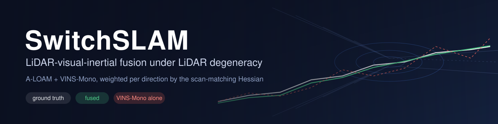
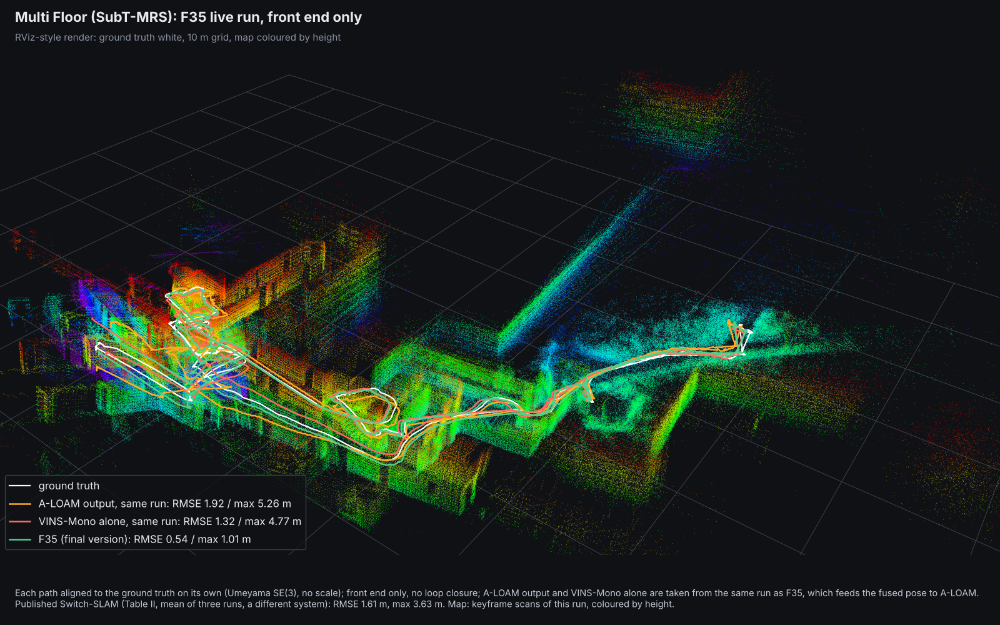
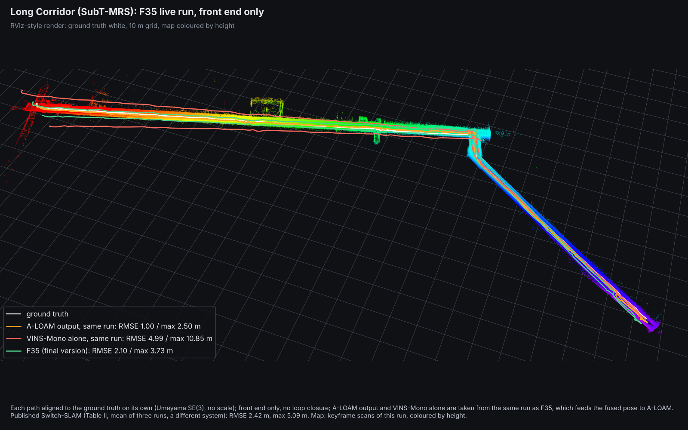
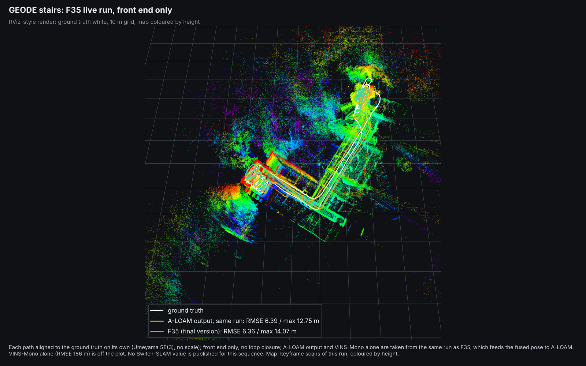
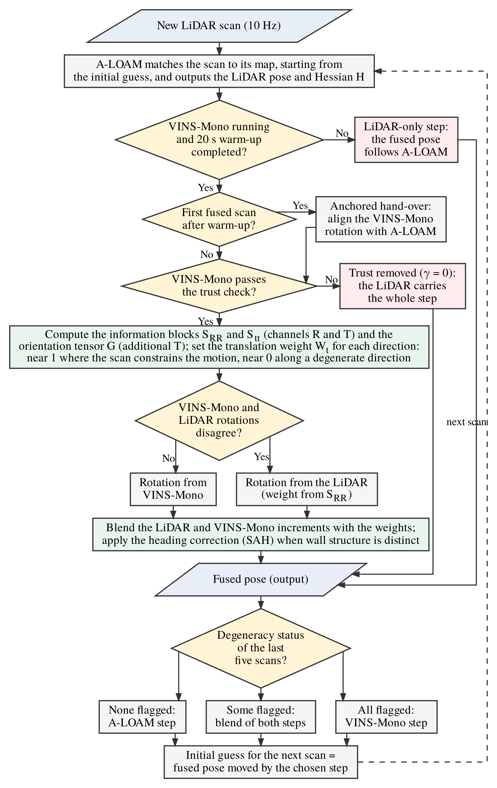

<p align="center"></p>

<p align="center">
  
  
  
  
  
</p>

<p align="center">
  <a href="#results">Results</a> ·
  <a href="#how-it-works">How it works</a> ·
  <a href="#quick-start">Quick start</a> ·
  <a href="#repository-map">Repository map</a> ·
  <a href="#versions-and-names">Versions</a> ·
  <a href="#limits-and-status">Limits</a> ·
  <a href="docs/README.md">Docs</a> ·
  <a href="docs/thesis/README.md">Thesis</a>
</p>

---

## What this is

A LiDAR scan taken in a corridor or a stairwell does not constrain the motion along the axis, so LiDAR odometry slides. VINS-Mono does not have that problem but drifts in scale and heading. This project fuses the two **per direction**: rotation comes from VINS-Mono; translation comes from A-LOAM along the directions its scan matching constrains (read from the Schur complement of its Hessian) and from VINS-Mono along the others. Where VINS-Mono is unusable (warm-up, loss, a failed trust check) the LiDAR carries the whole step. The final version, **F35 in the thesis (tag `F26` in the repo)**, also chooses A-LOAM's starting guess from the degeneracy status and adds safeguards: a VIO-trust check, an anchored hand-over and a mapping-guess guard.

It is compared with the published Switch-SLAM on SubT-MRS Multi Floor and Long Corridor and a Gazebo farm route, and tested on Corridor02, Cave02 and GEODE stairs, where no Switch-SLAM value is published. Front end only, no loop closure.

M.Tech thesis of Kavinkumar S (CB.EN.P2MFA25004), advisor Dr. G. Sivasankar. Everything needed to redraw the figures and rebuild the report is in this repository.

## Results

ATE RMSE in metres (Umeyama SE(3) alignment, no scale), full span, live runs. Mean over the runs of each cell; `n` is the number of F35 runs.

| Sequence | **F35 (final)** | n | VINS-Mono alone | A-LOAM alone | Switch-SLAM, published (RMSE / max) |
|---|---|---|---|---|---|
| Multi Floor | **0.54** | 1 | 1.28 | 26.4 | 1.61 / 3.63 |
| Long Corridor | **2.10** | 1 | 5.81 | 15.8 | 2.42 / 5.09 |
| Corridor02 | **1.99** | 2 | 4.03 | 66.0 | none published |
| Cave02 | **6.23** | 1 | 10.2 | not run | none published |
| GEODE stairs | **5.04** | 3 | 204.6 | not run | none published |
| Gazebo farm route | **0.290** | 1 | 9.39 | 0.478 | 0.38 / 1.10 |

F35 had the lowest mean error of the three on every sequence where all three were run. Only one comparison is statistically significant with an exact test (F35 against VINS-Mono alone on GEODE stairs, p = 0.008): the cells hold one to three runs, every sequence was used during development, and the published values come from a different system, so the margin over Switch-SLAM is not established. On Cave02 the earlier versions F8 and F16 (4.4 to 4.5 m) were better than F35. Full tables, tests and caveats: [`docs/thesis/`](docs/thesis/README.md).

<table>
<tr>
<td align="center"><br><sub>Multi Floor · ATE 0.54 m</sub></td>
<td align="center"><br><sub>Long Corridor · 2.10 m</sub></td>
<td align="center"><br><sub>Corridor02 · 1.93 m (run 1)</sub></td>
</tr>
<tr>
<td align="center"><br><sub>Cave02 · 6.23 m</sub></td>
<td align="center"><br><sub>GEODE stairs · 6.36 m (run 1)</sub></td>
<td align="center"><br><sub>Farm L route (Gazebo) · 0.290 m</sub></td>
</tr>
</table>

<sub>White: ground truth. Green: F35. Orange: the A-LOAM output of the same run, which F35 feeds back (it is not stock A-LOAM). Red: VINS-Mono alone from the same run, where it stays on the plot. Per-bag trajectory videos: [`docs/thesis/videos_final/`](docs/thesis/videos_final/).</sub>

## How it works

<p align="center"></p>

For every LiDAR scan the node `fusion_v4/fusion_node_v2.py` receives A-LOAM's scan-to-map pose and Hessian and VINS-Mono's pose, weights the translation per direction, checks that VINS-Mono can be trusted, and publishes the fused pose, which becomes A-LOAM's initial guess for the next scan. Method chapter: [`docs/thesis/`](docs/thesis/README.md); every design step and test rule: [`docs/results/`](docs/README.md).

## Quick start

Three levels, from nothing to everything.

**1. Redraw the figures** (Python only, no bags, no ROS, about a minute):
```bash
pip install -r requirements.txt
cd docs/thesis/scripts
FIG_OUT=/tmp/regen python3 render_final.py MF LC C02 CAVE GEODE FARM       # pixel-identical to docs/thesis/figures_final/
FIG_OUT=/tmp/regen python3 render_aloam_alone.py LC ../figure_data/data/for_claude7/*.csv.gz
```
The inputs (run logs, keyframe maps, ground truth, SHA-256 manifest) are in [`docs/thesis/figure_data/`](docs/thesis/figure_data/MANIFEST.md).

**2. Rerun the experiments** (needs the bags and Docker; the thesis runs were made on a laptop with 16 GB of RAM): [`docs/setup/INSTALL.md`](docs/setup/INSTALL.md) → [`DATASETS.md`](docs/setup/DATASETS.md) → [`REPRODUCE.md`](docs/setup/REPRODUCE.md). One run is one command, for example
```bash
cd fusion_v4 && FRONT=aloam REPEAT=1 PLAY_RATE=1.0 ./run_fusion_study.sh F26      # final version, Multi Floor
REPEAT=1 PLAY_RATE=1.0 ./stock_aloam/run_stock_aloam.sh mf -          # stock A-LOAM on the same bag
```

**3. Rebuild the report**: `bash docs/thesis/scripts/v3_rewrite/setup_workdir.sh && cd /tmp/w/v3 && bash pipe.sh` (steps in [`docs/thesis/README.md`](docs/thesis/README.md)).

## Repository map

| Folder | What is in it |
|---|---|
| [`fusion_v4/`](fusion_v4/) | **the system and its studies**: fusion node, scoring, batch scripts (`batches/`), stock A-LOAM runner (`stock_aloam/`), Gazebo worlds and screen (`gazebo/`), fault injection (`faults/`), GEODE and handheld setups |
| [`docs/thesis/`](docs/thesis/README.md) | the report (all versions), correction log, figures, videos, `figure_data/`, build scripts |
| [`docs/results/`](docs/README.md) | one document per version and study, F0 to F35, with the rules written before each test |
| [`docs/protocols/`](docs/README.md), [`docs/planning/`](docs/README.md), [`docs/research/`](docs/research/) | test protocols, plans, literature and derivations |
| [`docs/setup/`](docs/setup/) | install, datasets, environment capture, reproduction commands |
| [`docs/paper/`](docs/paper/) | the 8-page paper (`main.tex`) and its figure scripts |
| `fusion_v2/`, `fusion_v3/` | earlier generations of the fusion node, kept self-contained |
| `sah/`, `analysis/`, `threshold_study/`, `channelT_test/` | development harnesses: structure-anchored heading, replays and statistics, threshold screening, channel-T tests |
| `patches/`, `configs/`, `tools/`, `scripts/` | changes to A-LOAM and VINS-Mono, per-sequence container configs, environment capture, helpers |
| `switchslam_v1/` | generation 1 (Sep 2026): the original switching nodes |
| `results_data/` | raw logs of the early studies (22 to 27 Oct) |

Bags (`.bag`) and run folders are not stored (see `.gitignore`); the keyframe maps used by the figures are the one exception.

## Versions and names

| Name in the thesis | Tag in the repo | What it is |
|---|---|---|
| VINS-Mono alone / A-LOAM alone | `F0` / `F5` | the two estimators on their own (F5 runs through the fusion node with A-LOAM's last pose as guess) |
| F8 | `F8` | first working fusion: translation weighted per direction (channel T) |
| F16 | `F16` | F8 plus the structure-anchored heading (SAH) |
| F20 to F24 | `F20` to `F24` | adds channel R and the orientation tensor, then the safeguards of F21 to F24 |
| **F35 (final)** | **`F26`** | F24 with the starting guess of A-LOAM's scan-to-map chosen from the degeneracy status (Switch-SLAM thresholds) |
| F26 (channels only) | `F35` | the same, with the status decided by our own channels |
| G0 to G20 | `G*` | the GenZ-LIO front-end variants of October (`FRONT=genz`) |

The report and the repo use swapped names for the last two rows; the map is entry A10 of [`docs/thesis/Report_Corrections_Log.md`](docs/thesis/Report_Corrections_Log.md). Definitions of the early configurations: [`docs/results/Configurations_Explained_and_Results_To_Date.md`](docs/results/Configurations_Explained_and_Results_To_Date.md).

## Limits and status

- One to three live runs per cell, so single runs support no claim; all six sequences were used while developing F35, so none is a held-out test.
- Front end only: no loop closure in any number above. The comparison with Switch-SLAM is not like for like (A-LOAM without IMU, per-direction weights instead of switching, one to four runs against the authors' three-run mean).
- Stock A-LOAM views for the figures: one Long Corridor run is done (13.25 / 24.29 m); Multi Floor, Corridor02, Cave02, GEODE and the farm are still to run with [`fusion_v4/stock_aloam/`](fusion_v4/stock_aloam/README.md).
- GEODE and Cave02 values for A-LOAM alone are not in the thesis tables; the paper keeps one GEODE run (7.98 / 22.09 m) from another machine.

## Cite

See [`CITATION.cff`](CITATION.cff). Active branch: `f22-handover`; `main` holds the earlier state.
