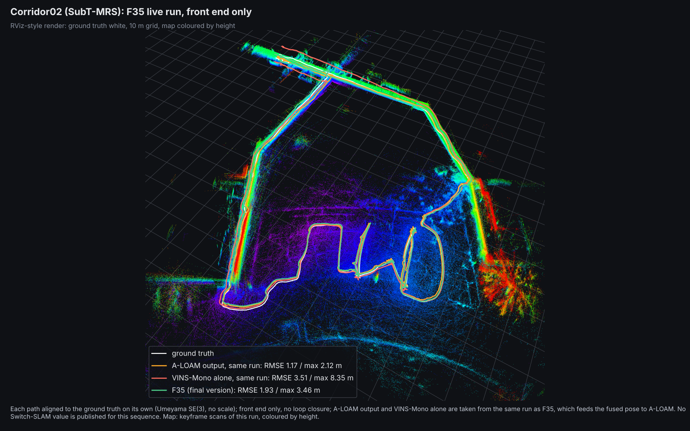
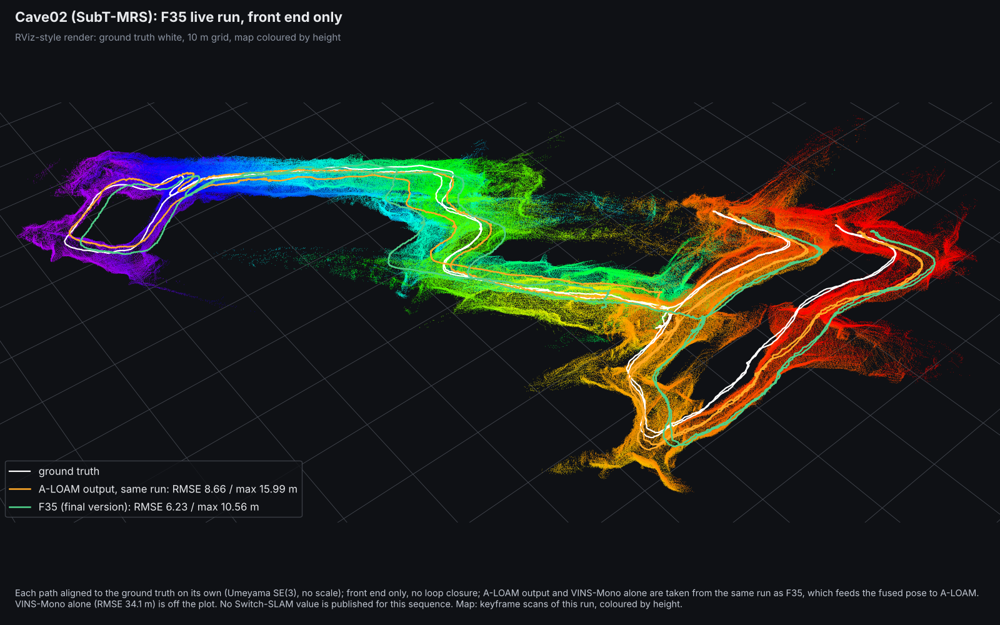
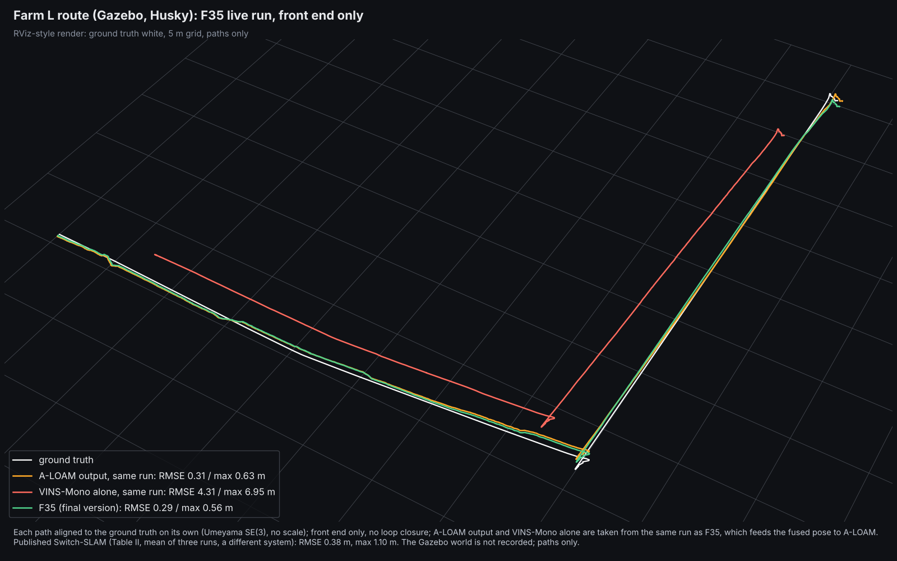
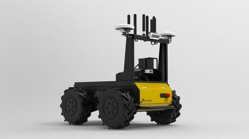
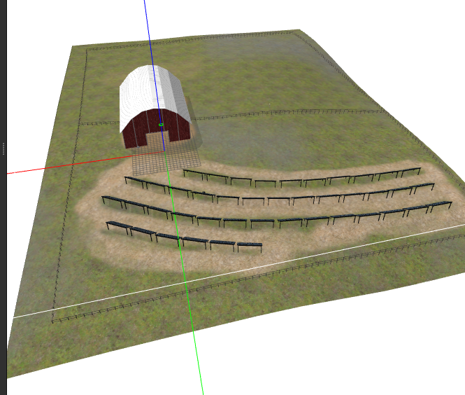

<p align="center"></p>

# SwitchSLAM
## LiDAR-visual-inertial fusion under LiDAR degeneracy

<p>
  
  
  
  
</p>

[1 Introduction](#1-introduction) · [2 Prerequisites](#2-prerequisites) · [3 Setup](#3-setup) · [4 Run](#4-run-the-package) · [5 Repository map](#5-repository-map) · [6 Experimental setup](#6-experimental-setup) · [7 Limits and status](#7-limits-and-status) · [8 Acknowledgments](#8-acknowledgments) · [Docs](docs/README.md)

### News

- **Nov 18, 2026**: project page rebuilt; the logs, keyframe maps and ground truth behind the figures are in [`docs/thesis/figure_data/`](docs/thesis/figure_data/MANIFEST.md), so the RViz-style images redraw without bags or ROS.
- **Nov 2026**: stock A-LOAM runner added ([`fusion_v4/stock_aloam/`](fusion_v4/stock_aloam/README.md)); one run each on five bag sequences and on the Gazebo farm route, logs in `figure_data/stock/`.
- **Nov 16, 2026**: thesis report v3 with extended introduction, literature review and flowcharts ([`docs/thesis/`](docs/thesis/README.md)).
- **Nov 11, 2026**: final version F35 (repo tag `F26`) tested on all six sequences; per-sequence renders and videos added.
- **Oct 2026**: structure-anchored heading, GenZ-LIO front-end variants, orientation-tensor channel, fault-injection tests.

## 1. Introduction

A LiDAR scan taken in a corridor or a stairwell does not constrain the motion along the axis, so LiDAR odometry slides. VINS-Mono does not have that problem but drifts in scale and heading. This work fuses the two **per direction**: rotation comes from VINS-Mono; translation comes from A-LOAM along the directions its scan matching constrains (read from the Schur complement of its Hessian) and from VINS-Mono along the others. Where VINS-Mono is unusable (warm-up, loss, a failed trust check) the LiDAR carries the whole step. The final version, **F35 in the thesis (tag `F26` in the repo)**, also chooses A-LOAM's starting guess from the degeneracy status and adds three safeguards: a VIO-trust check, an anchored hand-over and a mapping-guess guard.

<p align="center"><a href="docs/thesis/figures_final/flowcharts/perscan.png"></a></p>
<p align="center"><sub>Processing of one LiDAR scan in the fusion node (<code>fusion_v4/fusion_node_v2.py</code>).</sub></p>

### 1.1 Thesis and citation

M.Tech thesis of Kavinkumar S (CB.EN.P2MFA25004), advisor Dr. G. Sivasankar. The report, its correction log and the build scripts are in [`docs/thesis/`](docs/thesis/README.md); the 8-page paper is in [`docs/paper/`](docs/paper/). If you use this work, please cite:

```bibtex
@mastersthesis{kavinkumar2026switchslam,
  author = {Kavinkumar S},
  title  = {LiDAR-visual-inertial fusion under LiDAR degeneracy},
  year   = {2026},
  note   = {M.Tech thesis, CB.EN.P2MFA25004; advisor Dr. G. Sivasankar}
}
```

### 1.2 Results

ATE RMSE in metres (Umeyama SE(3) alignment, no scale), full span, live runs. Mean over the runs of each cell; `n` is the number of F35 runs.

| Sequence | **F35 (final)** | n | VINS-Mono alone | A-LOAM alone | Switch-SLAM, published (RMSE / max) |
|---|---|---|---|---|---|
| Multi Floor | **0.54** | 1 | 1.28 | 26.4 | 1.61 / 3.63 |
| Long Corridor | **2.10** | 1 | 5.81 | 15.8 | 2.42 / 5.09 |
| Corridor02 | **1.99** | 2 | 4.03 | 66.0 | none published |
| Cave02 | **6.23** | 1 | 10.2 | not run | none published |
| GEODE stairs | **5.04** | 3 | 204.6 | not run | none published |
| Gazebo farm route | **0.290** | 1 | 9.39 | 0.478 | 0.38 / 1.10 |

F35 had the lowest mean error of the three on every sequence where all three were run. Only one comparison is statistically significant with an exact test (F35 against VINS-Mono alone on GEODE stairs, p = 0.008): the cells hold one to three runs, every sequence was used during development, and the published values come from a different system, so the margin over Switch-SLAM is not established. On Cave02 the earlier versions F8 and F16 (4.4 to 4.5 m) were better than F35. Full tables, tests and caveats: [`docs/thesis/`](docs/thesis/README.md).

<table>
<tr>
<td align="center"><br><sub>Multi Floor · ATE 0.54 m</sub></td>
<td align="center"><br><sub>Long Corridor · 2.10 m</sub></td>
<td align="center"><br><sub>Corridor02 · 1.93 m (run 1)</sub></td>
</tr>
<tr>
<td align="center"><br><sub>Cave02 · 6.23 m</sub></td>
<td align="center"><br><sub>GEODE stairs · 6.36 m (run 1)</sub></td>
<td align="center"><br><sub>Farm L route (Gazebo) · 0.290 m</sub></td>
</tr>
</table>

<sub>White: ground truth. Green: F35. Orange: the A-LOAM output of the same run, which F35 feeds back (it is not stock A-LOAM). Red: VINS-Mono alone from the same run, where it stays on the plot. Per-bag trajectory videos: [`docs/thesis/videos_final/`](docs/thesis/videos_final/).</sub>

### 1.3 Related videos

One trajectory video per sequence (top-down map, paths against ground truth, error panel, fusion mode strip), from the same live runs as the images above: [Multi Floor](docs/thesis/videos_final/MF_F35_final.mp4) · [Long Corridor](docs/thesis/videos_final/LC_F35_final.mp4) · [Corridor02](docs/thesis/videos_final/C02_F35_final.mp4) · [Cave02](docs/thesis/videos_final/CAVE_F35_final.mp4) · [GEODE stairs](docs/thesis/videos_final/GEODE_F35_final.mp4) · [Farm](docs/thesis/videos_final/FARM_F35_final.mp4).

## 2. Prerequisites

### 2.1 Host

Linux with Docker, about 60 GB of free disk (bags are 4 to 23 GB each) and 16 GB of RAM; the thesis runs were made on a laptop with a Ryzen 5 5600H, a GTX 1650 and Ubuntu. The slower replays (0.33x to 0.5x) exist because A-LOAM, VINS-Mono and the fusion node together need that headroom.

### 2.2 Containers

| Container | Base | Holds |
|---|---|---|
| `switchslam_gpu_v2` | ROS Noetic | A-LOAM (patched), GenZ-LIO, the fusion node and the scorers |
| `vinsmono_test` | ROS Kinetic | VINS-Mono (patched): feature tracker and estimator |
| `ros:noetic` (per run) | ROS Noetic | `rosbag play --clock` of the bag |

Revisions, patches and the captured environment: [`docs/setup/ENVIRONMENT.md`](docs/setup/ENVIRONMENT.md), [`patches/aloam_vins/`](patches/aloam_vins/).

### 2.3 Python

```bash
pip install -r requirements.txt        # numpy, scipy, pandas, matplotlib, scikit-learn, pyyaml, gtsam
```

### 2.4 Datasets

| Sequence | Source | Role in the thesis |
|---|---|---|
| Multi Floor (SubT-MRS, legged robot) | SubT-MRS / SuperLoc | tuning sequence, compared with Switch-SLAM |
| Long Corridor (SubT-MRS Corridor01, wheeled RC) | SubT-MRS | development, compared with Switch-SLAM |
| Corridor02 (SuperLoc Hawkins, RC) | SuperLoc | development |
| Cave02 (SuperLoc Laurel Cavern, handheld) | SuperLoc | control, then used in development |
| GEODE stairs, device alpha | [GEODE](https://thisparticle.github.io/geode/) | development |
| Farm L route | Gazebo, Clearpath Husky | compared with Switch-SLAM |

Download links, folder layout and topics: [`docs/setup/DATASETS.md`](docs/setup/DATASETS.md). The bags are not in the repository.

## 3. Setup

```bash
git clone -b f22-handover https://github.com/Kevinparker11/switchslam-project.git
cd switchslam-project
bash fusion_v4/clean_restart.sh              # restarts both containers, no leftover ROS processes
```

Containers: move them from a working machine with `tools/export_images.sh` and `tools/import_images.sh`, or rebuild from source (section 2B of [`docs/setup/INSTALL.md`](docs/setup/INSTALL.md)). Sequence settings are written by `fusion_v4/setup_sequence.sh` into `~/runs_<name>/seq.env`.

## 4. Run the package

### 4.1 Important parameters

Set as environment variables of `fusion_v4/run_fusion_study.sh`:

- **`FRONT=aloam`**: the A-LOAM stack of the thesis (`genz` is the default and selects the GenZ-LIO variants).
- **`SEQ_ENV=~/runs_<name>/seq.env`**: a sequence other than Multi Floor.
- **`REPEAT=n`**: n live repeats per configuration (tags `<cfg>_run<k>`).
- **`PLAY_RATE=r`**: replay the bag at r times real time; the thesis uses 1.0 (Multi Floor, Long Corridor), 0.33 (Corridor02) and 0.5 (Cave02, GEODE).
- **`RECORD_KF=1`**: also save the keyframe scans (`.npz`), needed for the map in the renders.
- **`SMOKE=1`**: short run without scoring.

The configurations are the first argument (`F0` VINS-Mono alone, `F5` A-LOAM alone, `F8`, `F16`, `F24`, `F26` final). Every variable and its default: [`docs/setup/REPRODUCE.md`](docs/setup/REPRODUCE.md).

### 4.2 One run of the final version

```bash
cd fusion_v4
FRONT=aloam REPEAT=1 PLAY_RATE=1.0 ./run_fusion_study.sh F26       # Multi Floor; the log and the ATE go to the run folder
```

### 4.3 Stock A-LOAM

The unmodified A-LOAM on the same bag, for the A-LOAM line in the figures:

```bash
REPEAT=1 PLAY_RATE=1.0 ./stock_aloam/run_stock_aloam.sh mf -                               # Multi Floor
REPEAT=1 PLAY_RATE=1.0 ./stock_aloam/run_stock_aloam.sh lc ~/runs_corridor/seq.env         # Long Corridor
```

### 4.4 Redraw the figures (no bags, no ROS)

```bash
cd docs/thesis/scripts
FIG_OUT=/tmp/regen python3 render_final.py MF LC C02 CAVE GEODE FARM        # identical to docs/thesis/figures_final/
FIG_OUT=/tmp/regen python3 render_aloam_alone.py LC ../figure_data/data/for_claude7/*.csv.gz
```

### 4.5 Rebuild the report

```bash
bash docs/thesis/scripts/v3_rewrite/setup_workdir.sh && cd /tmp/w/v3 && bash pipe.sh
```

## 5. Repository map

| Folder | What is in it |
|---|---|
| [`fusion_v4/`](fusion_v4/) | the system and its studies: fusion node, scoring, batch scripts, stock A-LOAM runner, Gazebo worlds, fault injection |
| [`docs/thesis/`](docs/thesis/README.md) | the report (all versions), correction log, figures, videos, figure inputs, build scripts |
| [`docs/results/`](docs/README.md) | one document per version and study, with the rules written before each test |
| [`docs/protocols/`](docs/README.md), [`docs/planning/`](docs/README.md), [`docs/research/`](docs/research/) | test protocols, plans, literature and derivations |
| [`docs/setup/`](docs/setup/) | install, datasets, environment capture, reproduction commands |
| [`docs/paper/`](docs/paper/) | the paper (`main.tex`) and its figure scripts |
| `fusion_v2/`, `fusion_v3/` | earlier generations of the fusion node, each self-contained |
| `sah/`, `analysis/`, `threshold_study/`, `channelT_test/` | development harnesses: structure-anchored heading, replays and statistics, threshold screening, channel-T tests |
| `patches/`, `configs/`, `tools/`, `scripts/` | changes to A-LOAM and VINS-Mono, per-sequence configs, environment capture, helpers |
| `switchslam_v1/`, `results_data/` | generation 1 (Sep 2026) and the raw logs of the early studies |

### Versions and names

| Name in the thesis | Tag in the repo | What it is |
|---|---|---|
| VINS-Mono alone / A-LOAM alone | `F0` / `F5` | the two estimators on their own (F5 runs through the fusion node with A-LOAM's last pose as guess) |
| F8 | `F8` | first working fusion: translation weighted per direction (channel T) |
| F16 | `F16` | F8 plus the structure-anchored heading (SAH) |
| F20 to F24 | `F20` to `F24` | adds channel R and the orientation tensor, then the safeguards of F21 to F24 |
| **F35 (final)** | **`F26`** | F24 with the starting guess of A-LOAM's scan-to-map chosen from the degeneracy status (Switch-SLAM thresholds) |
| F26 (channels only) | `F35` | the same, with the status decided by our own channels |
| G0 to G20 | `G*` | the GenZ-LIO front-end variants of October (`FRONT=genz`) |

The report and the repo use swapped names for the last two rows; the map is entry A10 of [`docs/thesis/Report_Corrections_Log.md`](docs/thesis/Report_Corrections_Log.md). Early configurations: [`docs/results/Configurations_Explained_and_Results_To_Date.md`](docs/results/Configurations_Explained_and_Results_To_Date.md).

## 6. Experimental setup

All live runs were made on one laptop (Ryzen 5 5600H, GTX 1650 with 4 GB, 16 GB RAM, Ubuntu, Docker). The sequences come from different platforms: a legged robot (Multi Floor), wheeled RC robots (Long Corridor, Corridor02), a handheld rig (Cave02), the GEODE alpha device (stairs) and a simulated Clearpath Husky in a Gazebo agriculture world (farm L route, 80 m).

<p align="center"><a href="docs/thesis/figures_final/gaz_husky.jpg"></a> <a href="docs/thesis/figures_final/gaz_world.png"></a></p>

## 7. Limits and status

- One to three live runs per cell, so single runs support no claim; all six sequences were used while developing F35, so none is a held-out test.
- Front end only: no loop closure in any number above. The comparison with Switch-SLAM is not like for like (A-LOAM without IMU, per-direction weights instead of switching, one to four runs against the authors' three-run mean).
- Stock A-LOAM (one run each, RMSE / max in m): Multi Floor 5.22 / 9.51, Long Corridor 13.25 / 24.29, Corridor02 7.64 / 11.56, Cave02 6.62 / 12.73, GEODE 3.58 / 9.54; Farm (Gazebo, live) 0.41 / 0.80 over the first 380 s. On GEODE the stock run is below the F35 mean (5.04 m) and on Cave02 it is level with F35 (6.23 m); one run each, so neither is a claim.
- A-LOAM alone on Cave02 and GEODE is not in the thesis tables; the paper keeps one GEODE run (7.98 / 22.09 m) from another machine.

## 8. Acknowledgments

This work builds on [A-LOAM](https://github.com/HKUST-Aerial-Robotics/A-LOAM) and [VINS-Mono](https://github.com/HKUST-Aerial-Robotics/VINS-Mono) (HKUST Aerial Robotics Group), GenZ-LIO and iG-LIO as alternative front ends, and the Switch-SLAM paper whose structure and published values are the reference. Data: SubT-MRS and SuperLoc (Multi Floor, Corridor, Cave), [GEODE](https://thisparticle.github.io/geode/). Trajectories are aligned with the Umeyama method.

## 9. License

The code of this repository is released under the [MIT License](LICENSE). The files in [`patches/`](patches/) are modifications of A-LOAM (BSD-3-Clause) and VINS-Mono (GPL-3.0) and stay under the licenses of those projects; GenZ-LIO and iG-LIO also keep their own. The thesis report and the figures are not covered by the MIT License. For questions or problems, open an issue on this repository.
